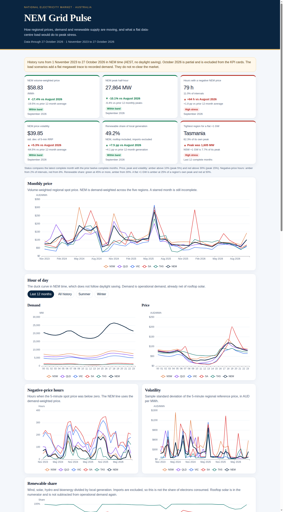
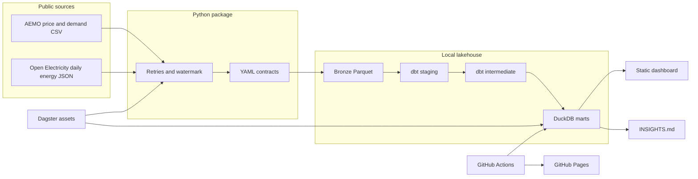
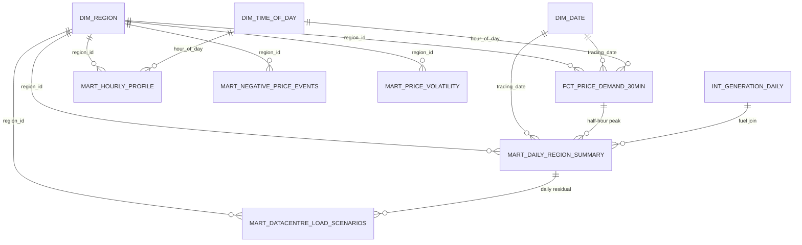
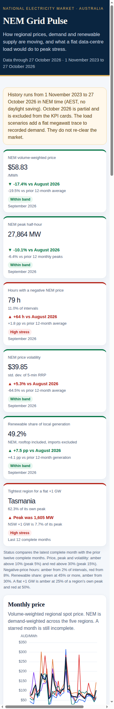

# NEM Grid Pulse

[](https://github.com/LuciferDataEngineer/nem-grid-pulse/actions/workflows/ci.yml)
[](https://luciferdataengineer.github.io/nem-grid-pulse/)


**Live dashboard:** https://luciferdataengineer.github.io/nem-grid-pulse/

A local analytics lakehouse for Australia's National Electricity Market. It tracks regional prices, demand, volatility, negative-price hours and renewable share, then asks a narrower question that the current policy debate keeps tripping over: what does a flat, always-on data-centre load do to residual demand and peak-hour stress?

The scenario maths are an illustrative energy balance. They are not a forecast.



## Why this matters now

On 20 October 2026 the Minister for Climate Change and Energy, Chris Bowen, asked the Australian Energy Market Commission to change the National Electricity Rules so that qualifying data centres have to back their load with firmed energy in the same region. The request is [ERC0461](https://www.aemc.gov.au/rule-changes/data-centre-contracting-obligation-firmed-energy). The [request PDF](https://www.aemc.gov.au/sites/default/files/2026-10/Contract%20obligation%20rule%20change%20request%20%281%29.pdf) cites AEMO's 2026 Electricity Statement of Opportunities: data-centre consumption of about 15 TWh, 7.8% of NEM operational consumption, by 2029-30, and about 34 TWh, 13%, by 2035-36 ([ESOO PDF](https://www.aemo.com.au/-/media/files/electricity/nem/planning_and_forecasting/nem_esoo/2026/2026-electricity-statement-of-opportunities.pdf), and the [data-centre overview](https://www.aemo.com.au/-/media/files/electricity/nem/planning_and_forecasting/nem_esoo/2026/2026-esoo-data-centre-forecasting-overview.pdf)).

A week later the Smart Energy Council published modelling of a 5 GW "build first, catch up later" path and put the wholesale-cost impact at about [$40 billion](https://smartenergy.org.au/dirty-data-the-40-billion-ai-power-bill-from-fossil-fuel/) over six years. That is a price study. This project does not reproduce it. It answers the physical question underneath the argument: where the duck curve already is, how often prices are negative, and how many megawatts a flat load adds at the peak.

## Questions and headline results

The warehouse answers four questions. Figures below are from the marts, for 1 November 2023 to 27 October 2026, in NEM time (AEST, no daylight saving). September 2026 is the last complete month. October 2026 stops on the 27th.

1. **How have regional prices behaved?** Over the whole window the NEM volume-weighted price was **$105.14/MWh**. September 2026 was **$58.83/MWh**, 17.4% below August and 19.5% below the prior twelve-month average of $73.09. The jumpiest complete month in that prior year was November 2025, with a 5-minute standard deviation of **$245.87/MWh**. The highest 5-minute price in the extract is **$23,200/MWh** (NSW and Tasmania). The floor of **-$1,000/MWh** is reached.
2. **What does the day look like?** Over the last twelve complete months the NEM evening (17:00–20:00) averaged **25,767 MW** and the middle of the day (10:00–14:00) averaged **17,540 MW**. The gap is **8,227 MW**. South Australia's version of that gap is sharper: **818 MW** at midday against **1,685 MW** in the evening.
3. **When is the price negative, and how renewable is local supply?** September 2026 had **79 hours** with a negative demand-weighted NEM price, 11% of intervals, up from 15 hours in August. South Australia was negative for **217 hours**, 30.1% of intervals. November 2025 reached 25.7%. Renewable share of local generation (imports excluded) was **41.9%** across the window and **49.2%** in September 2026: Tasmania 91.9%, South Australia 84.1%, Queensland 40.5%.
4. **What does a flat +500 MW / +1 GW / +2 GW do?** It lifts every half-hour, including the peak, by exactly that many megawatts. It does not shrink the evening-minus-midday gap. Over the last twelve complete months the NEM half-hour peak was **33,457 MW**. Adding 1 GW in every region at once makes it **38,457 MW**, and **439** half-hours would sit above the old peak. The same +1 GW is **7.7%** of New South Wales' 13,024 MW peak (10 new record half-hours) and **62.3%** of Tasmania's 1,605 MW peak (17,212 half-hours above the record). A per-region gigawatt is not one product.

September's NEM half-hour peak was **27,864 MW**, below the recent run of monthly peaks. Price, peak and volatility for that month sit inside the bands used on the dashboard. Negative-price hours and Tasmania's headroom for a flat gigawatt do not.

More of the narrative, with the same queries, is in [INSIGHTS.md](INSIGHTS.md).

## Architecture



Ingestion is idempotent. A complete month is not downloaded again. The current month, and the current generation year, stay marked incomplete and are refreshed. Contract breaches fail the run. A weekly workflow can miss AEMO entirely and still exit cleanly.

## Tech stack

| Piece | Choice | Why |
| --- | --- | --- |
| Warehouse | DuckDB | Column store in one file. Fast enough for the full NEM extract on a laptop and in CI. No hosted database. |
| Transform | dbt-duckdb | Staging, intermediate and marts, with tests, docs, sources, freshness and an exposure for the dashboard. |
| Ingest | Python, httpx, pydantic | Retries, a high-watermark file, and a YAML contract checked before anything is written to bronze. |
| Orchestration | Dagster assets | One asset each for bronze, the dbt build, and the dashboard. The Makefile is the everyday interface. |
| Quality | dbt tests + contract YAML | Both fail the pipeline. CI rebuilds the warehouse from the committed Parquet, offline. |
| Dashboard | ECharts in one HTML file | No server at read time. Every number is queried from the marts when the file is built. |
| CI and hosting | GitHub Actions and Pages | Free tier. Pages publishes `dashboard/dist`. |

## Data sources

All of this is free. No API keys and no paid services. The cached Parquet is the reproducible snapshot. Source URLs, fetch timestamps and sha256 hashes of both the original bytes and the Parquet are in [`data/manifest.json`](data/manifest.json).

| Publisher | Dataset | URL | Terms | Coverage in this repo | Grain | Access | Cost |
| --- | --- | --- | --- | --- | --- | --- | --- |
| AEMO | Aggregated price and demand | [`PRICE_AND_DEMAND_YYYYMM_REGION1.csv`](https://www.aemo.com.au/aemo/data/nem/priceanddemand/PRICE_AND_DEMAND_202509_NSW1.csv) on [aemo.com.au](https://www.aemo.com.au/energy-systems/electricity/national-electricity-market-nem/data-nem/aggregated-data). `aemo.com.au/...` redirects here. | [AEMO copyright permissions](https://www.aemo.com.au/privacy-and-legal-notices/copyright-permissions): public AEMO Material may be used with attribution. The MIT licence on this repo does not cover the data. | NSW1, QLD1, VIC1, SA1, TAS1. November 2023 through 27 October 2026. | 5-minute `RRP` and `TOTALDEMAND`. `PERIODTYPE` is `TRADE`. | 28 October 2026 | Free |
| Open Electricity | Daily energy by fuel technology | Public static JSON, for example [NSW1 2025](https://data.openelectricity.org.au/v4/stats/au/NEM/NSW1/energy/2025.json). No key. | Open Electricity republishes AEMO-derived statistics. Attribute Open Electricity and AEMO. Confirm current terms before any commercial reuse. The authenticated API was not used. | Same five regions, calendar years 2023–2026. | Daily GWh by fuel technology. | 28 October 2026 | Free |
| AEMC | ERC0461 rule change request | [PDF](https://www.aemc.gov.au/sites/default/files/2026-10/Contract%20obligation%20rule%20change%20request%20%281%29.pdf) | AEMC publication. Cited, not ingested. | 20 October 2026 request. | Policy context. | 28 October 2026 | Free |
| AEMO | 2026 ESOO | [PDF](https://www.aemo.com.au/-/media/files/electricity/nem/planning_and_forecasting/nem_esoo/2026/2026-electricity-statement-of-opportunities.pdf) | AEMO Material, used with attribution. Cited, not ingested. | Data-centre forecast context. | Annual forecast. | 28 October 2026 | Free |
| Smart Energy Council | $40 billion hike | [Article](https://smartenergy.org.au/dirty-data-the-40-billion-ai-power-bill-from-fossil-fuel/) | SEC publication. Cited as external modelling. Not reproduced. | 26 October 2026 analysis. | Price scenario, not used as an input. | 28 October 2026 | Free |

AEMO's current aggregated files are 5-minute. There is no second 30-minute feed to download. The half-hour fact is the mean of each six 5-minute intervals, which is the trading-interval grain people still use for peaks. Half-hours with fewer than six intervals are dropped. A complete month in this extract has 8,064 to 8,928 five-minute rows; October 2026 has 7,776 (27 days) and is flagged incomplete.

Open Electricity's rolling 7-day power files exist, and the yearly power files returned 403 without a key. Daily energy is what could be cached for the whole window without an account. Hour-of-day renewable shape is therefore not in the marts. Operational demand by hour is, and it already shows the duck, because rooftop PV is behind the meter.

## How the layers are built

**Bronze.** One Parquet partition per region-month for prices, and per region-year for generation. Hive-style paths, columns stored in the file. Each file is validated against [`contracts/price_demand.yaml`](contracts/price_demand.yaml) or [`contracts/generation_daily.yaml`](contracts/generation_daily.yaml) before it is written. South Australian operational demand is allowed to be negative, down to -2,000 MW: AEMO publishes that when rooftop supply exceeds regional consumption (the extract reaches about -311 MW). Prices must sit between the market floor of -1,000 and 30,000 AUD/MWh. The observed maximum is 23,200.

**Staging.** Cast types, keep the five regions, and attach a trading date and a clock hour. The interval ending at 00:00 belongs to the previous trading day. Hour 0 contains the half-hours ending 00:30 and 01:00. Timestamps stay in NEM time. They are not shifted to local daylight saving time, which would make a Queensland hour and a Victorian hour disagree inside the same market interval.

**Intermediate.**

- `int_price_demand_30min` buckets six 5-minute rows. Demand is the average MW. Both a time-weighted and a demand-weighted price are kept.
- `int_nem_price_demand_5min` keeps a timestamp only when all five regions are present, sums demand, and demand-weights the price. Summing regional demand is valid because net interconnector flows cancel.
- `int_generation_daily` classifies fuels. Renewables are wind, utility solar, rooftop solar, hydro and biomass. Fossil is black and brown coal, the gas technologies including waste coal mine gas, and distillate. Grid-scale variable renewables, used for residual energy, are wind and utility solar only. Rooftop is not subtracted again. Imports, exports, pumps, charging and curtailment stay out of the generation total.
- `int_analysis_months` marks complete months and the latest twelve of them. October 2026 is not in that twelve.

**Marts.**

| Model | Grain | What it is for |
| --- | --- | --- |
| `dim_region` | 5 regions + NEM | Names, colours, and the note that NEM time is not local time. |
| `dim_date` | Day | Calendar, season, weekend. Australian seasons. |
| `dim_time_of_day` | Hour 0–23 | Evening peak, midday, overnight. |
| `fct_price_demand_30min` | Region × half-hour | Incremental fact. Complete buckets only. |
| `mart_daily_region_summary` | Region × day, plus NEM | Prices, demand, negative hours, renewable share, residual energy. |
| `mart_hourly_profile` | Region × hour × slice | Duck curve for all history, summer, winter, and the last twelve complete months. |
| `mart_negative_price_events` | Region × month | Hours below zero, from the 5-minute price. |
| `mart_price_volatility` | Region × month | Standard deviation, interquartile range, and spike counts of the 5-minute price. |
| `mart_datacentre_load_scenarios` | Region × scenario × grain | Flat +0 / +500 / +1,000 / +2,000 MW. `is_forecast` is false on every row. |

Residual energy for a day is operational demand minus grid-scale wind and utility solar. The half-hour peak in the scenario mart is operational demand, which is already net of rooftop PV. Interval wind and solar were not available without a key or a multi-gigabyte SCADA archive, so the model does not invent a half-hourly residual. Daily residual energy is reported beside the half-hour peak, and the dashboard says so.

The fact is incremental (`delete+insert` on the half-hour key, with a two-day overlap). The aggregate marts are rebuilt. They are small, and the "last twelve complete months" flag moves.

## Data model



`mart_datacentre_load_scenarios.scenario_mw` is the per-region addition (0, 500, 1,000 or 2,000). On a regional row, `added_mw_on_series` equals that number. On the NEM row it equals five times that number, because the same flat load is applied in every region at once. The peak identity `scenario peak = baseline peak + added_mw_on_series` is a dbt test. So is the identity that the evening-minus-midday gap, in megawatts, does not change.

## Data quality

Two gates, both required:

1. **Contracts** in `contracts/`. The ingest refuses to land a file that breaks columns, keys, or ranges. `make transform` runs the same checks over the committed Parquet and compares sha256 hashes to the manifest. A file over 50 MB fails.
2. **dbt tests.** `not_null`, `unique`, `accepted_values`, `relationships`, the generic `column_between` test, and singular tests for the half-hour bucket, grain uniqueness, renewable-share bounds, unclassified fuels, and the scenario identities above. Sources carry a `loaded_at` freshness check (`make freshness`). It passes on this snapshot and is not on the CI critical path, so an old snapshot does not go red just because time passed.

Status colours on the dashboard are fixed rules, not a model score:

| Card | Green | Amber | Red |
| --- | --- | --- | --- |
| Price, volatility | Within 10% above the prior-12 average | 10–30% above | More than 30% above |
| Peak half-hour | Within 5% | 5–15% | More than 15% |
| Negative-price hours | Under 2% of intervals | 2–8% | 8% or more |
| Renewable share | 45% or more | 30–45% | Under 30% |
| +1 GW headroom | Under 25% of that region's peak | 25–50% | 50% or more |

September 2026 is green on price, peak, volatility and renewable share, and red on negative-price hours. Tasmania is red on the gigawatt test.

## Orchestration

Dagster assets live in `src/nem_grid_pulse/definitions.py`.

```bash
dagster asset materialize -m nem_grid_pulse.definitions --select '*'
```

`bronze_market_data` lands Parquet, `dbt_marts` validates and builds, `grid_pulse_dashboard` writes the HTML and `INSIGHTS.md`. The Makefile calls the same functions, which is what CI uses.

| Target | What it does |
| --- | --- |
| `make ingest` | Incremental download. |
| `make transform` | Contract check, then `dbt build`. |
| `make test` | pytest and `dbt test`. |
| `make lint` | `ruff check` and `ruff format --check`. |
| `make dashboard` | Rewrite insights and the static dashboard from the marts. |
| `make freshness` | `dbt source freshness`. |
| `make all` | Ingest, transform, test, lint, dashboard. |

## Run it

Python 3.11 or 3.12. From the repo root:

```bash
python -m pip install -e ".[dev]"
make transform    # uses the committed Parquet; no network
make dashboard
```

Open `dashboard/dist/index.html`. A refresh from the publishers, only when you want one:

```bash
make ingest
make all
```

`make ingest` skips complete partitions. Pass nothing extra for the default window (November 2023 through October 2026).

Docker, still with no hosted services:

```bash
docker compose build
docker compose run --rm lakehouse
```

The image runs `make transform` against the Parquet in the repo. Mount the data and dashboard directories if you want the outputs on the host. `make all` inside the container will try the network.

Dagster is optional. The pipeline does not need a daemon.

## Testing and CI

pytest covers the half-hour clock, contract failures, HTTP retries (including "404 is not retried" and "503 is"), the watermark, the status bands, manifest hashes, and, once the warehouse exists, the scenario identity and the study window.

[`.github/workflows/ci.yml`](.github/workflows/ci.yml) lints, runs pytest, builds the dbt project from the committed snapshot, runs pytest again so the mart checks see the warehouse, and builds the dashboard. It does not call AEMO.

[`.github/workflows/pages.yml`](.github/workflows/pages.yml) rebuilds the marts and the HTML on `main`, uploads `dashboard/dist` with `actions/upload-pages-artifact`, and deploys with `actions/deploy-pages`.

[`.github/workflows/refresh.yml`](.github/workflows/refresh.yml) runs weekly. `python -m nem_grid_pulse ingest --allow-source-failure` exits 0 when the publishers cannot be reached. A contract breach still fails. The workflow does not commit; it uploads the manifest as an artifact.

## Project structure

```text
src/nem_grid_pulse/     ingest, contracts, Dagster, dashboard
contracts/              YAML data contracts
dbt/                    staging, intermediate, marts, tests, exposures
data/bronze/            committed Parquet snapshot
data/manifest.json      URLs, fetch times, sha256
data/state/             high-watermark file
dashboard/              template, vendored ECharts, dist/index.html
reports/screenshots/    desktop and mobile renders
tests/                  pytest
.github/workflows/      ci, pages, weekly refresh
```

## Limitations

- The scenario model adds a constant. It does not redispatch plant, move interconnectors, or produce a price. The $40 billion figure is someone else's result and is labelled that way.
- +1 GW and +2 GW in Tasmania, and +2 GW in South Australia, are scale illustrations. They are larger than those regions' historical peaks. That is the point of showing them, and it is not a forecast of who will build there.
- Half-hour "residual demand" in the dashboard is operational demand. Grid-scale wind and solar are subtracted only in the daily energy balance.
- Renewable share is local generation. South Australia and Tasmania import a large share of the energy they consume. A high local renewable share is not the same as a high renewable share of consumption.
- NEM time is not local time. The duck curve for South Australia is plotted on the market clock.
- October 2026 is a partial month. KPI cards use September 2026. Charts mark the partial month.
- A handful of fuel readings, mostly Tasmanian gas, are a few hundredths of a GWh below zero. The fuel column keeps the published value. Only the share ratio floors those negatives at zero.
- The snapshot will go stale. `make ingest` is how it moves forward. CI will keep passing on the committed files either way.

## Next steps

- Swap the daily fuel totals for a sampled, aggregated SCADA history if a small public interval extract becomes available without a key, and build a true half-hour residual.
- Price the flat load with a published supply curve or a bid-stack sample, still labelled as a scenario, beside this energy balance.
- Split the firming question into energy, capacity at the evening peak, and flexibility into the negative-price hours, which the current one-number obligation mixes together.
- Point the weekly workflow at a branch and open a pull request when a new month lands, instead of only uploading the manifest.

## Licence

The code is [MIT](LICENSE). Copyright 2026 LuciferDataEngineer.

AEMO data cached under `data/bronze/` is AEMO Material, used with attribution under [AEMO's copyright permissions](https://www.aemo.com.au/privacy-and-legal-notices/copyright-permissions). Open Electricity statistics are included with attribution. Neither dataset is MIT.


